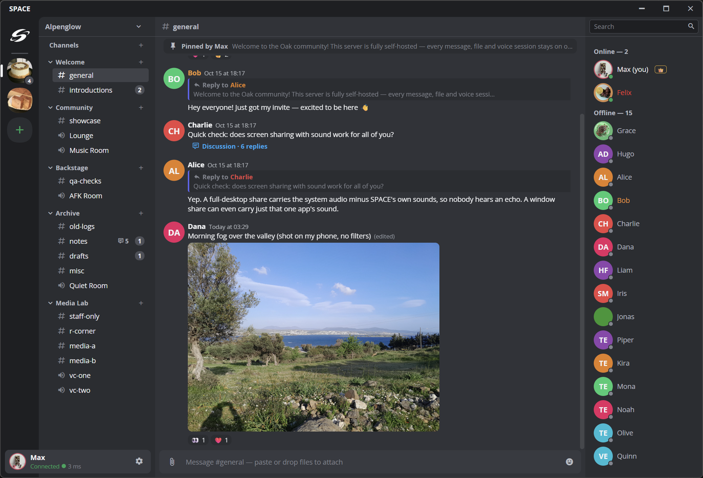
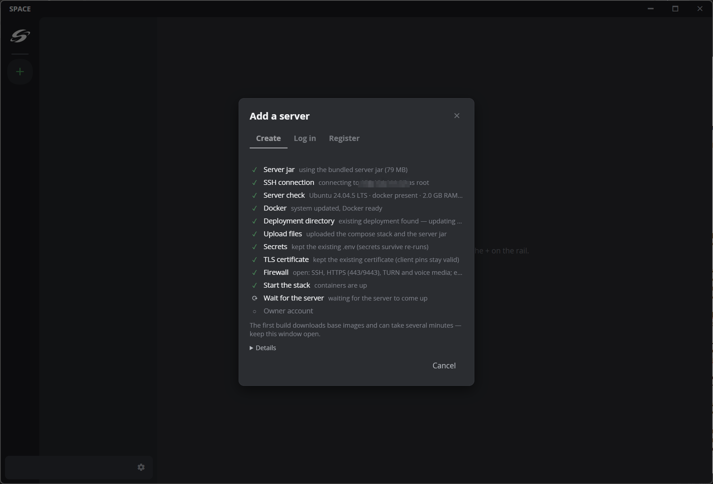
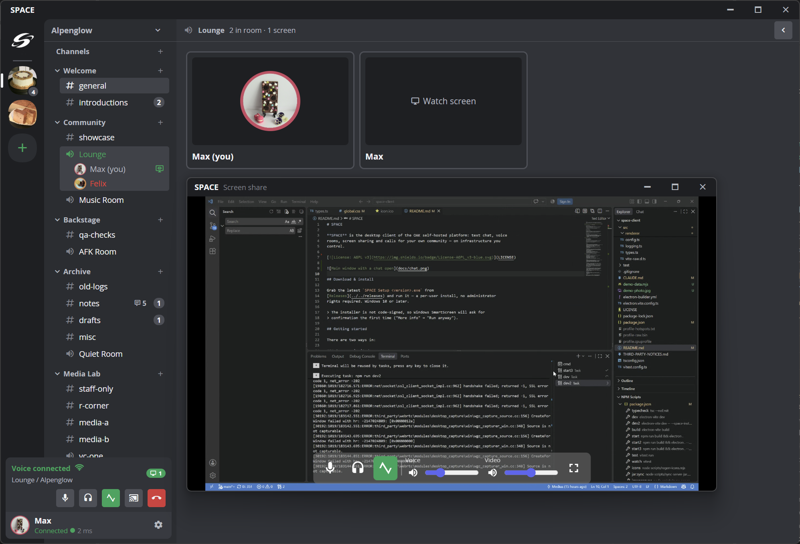

# SPACE

**SPACE** is the desktop client of the OAK self-hosted platform: text chat, voice
rooms, screen sharing and calls for your own community — on infrastructure you
control.

## Download & install

Grab the latest `SPACE Setup <version>.exe` from
[Releases](../../releases) and run it — a per-user install, no administrator
rights required. Windows 10 or later.

> The installer is not code-signed, so Windows SmartScreen will ask for
> confirmation the first time ("More info" → "Run anyway").

## Getting started

There are two ways in:

### Someone invited you

Ask a member with invite rights for an **invite link**, open SPACE, switch to
the **Register** tab and paste the link — the server address is filled in
automatically. Pick a nickname, login and password, and you are in.

### Run your own server

The **Create** tab turns a fresh Linux box into your community's home — right
from the client:

1. Enter the machine's IP address and the root SSH password.
2. SPACE connects over SSH and installs everything: Docker, the full OAK stack
   (chat server, PostgreSQL, object storage, voice gateway, TURN relay), a TLS
   certificate and a firewall — with individually generated secrets.
3. Your account is created as the server owner and you are logged in
   automatically.

What the server needs:

- Ubuntu or Debian, x86_64
- 2 GB RAM, 5+ GB free disk
- Root access over SSH

Prefer a domain name over a bare IP? Fill it in the Advanced section and the
setup obtains a Let's Encrypt certificate automatically.

Re-running setup on an existing installation adopts it in place — data,
accounts and client trust pins are preserved.

## Features

### Chat

- Text messages with instant delivery, editing and deletion
- Replies with nested quote chains; forwarding to any channel — including other servers
- Reactions, custom emoji and sticker packs (import/export as archives)
- `@user`, `@role` and `@everyone` mentions
- Message search across the server, jumping straight to the exact spot
- Pinned messages
- Discussion threads attached to any message
- Attachments: images, video, audio and files — gallery layout, fullscreen
  viewer, link previews

### Voice & calls

- Voice rooms with screen sharing — with system audio; a full-desktop share
  excludes the client's own sounds (viewers hear the desktop, not a doubled
  voice channel), and a window share can carry just that application's sound
- End-to-end encrypted 1-on-1 calls
- Camera in rooms and calls
- Per-user volume sliders
- Mute/deafen, and moderator mute/deafen/kick
- An AFK channel that idle members are moved to automatically
- Noise suppression with five engines, switchable live
- Voice invites, sharing quality presets, a pop-out viewer window and a
  connection quality indicator

### Server management

- Roles with fine-grained permissions, per-channel overrides, private and
  locked channels
- Channel categories with drag-and-drop ordering
- Invite links with a configurable lifetime
- Moderation: member bans and permanent removal from the server
- Ownership transfer
- Per-role restriction of direct messages
- Storage housekeeping with high/low disk watermarks
- Service health panel; server and client log export for problem reports

### Client

- Several servers side by side, with live background sessions and instant switching
- Friends, direct messages and group conversations
- Notifications: per-server modes, always-on-top toasts, in-app sounds
- Customizable hotkeys — including a global mute that works in games
- Dark theme, audio/video device settings, configurable image cache
- Built-in diagnostics with a one-click log archive

### Security

- TLS everywhere: Let's Encrypt for domains, pinned self-signed certificates
  for bare-IP servers (the fingerprint dialog is the pin being set — verify it
  with your server admin on first connect)
- 1-on-1 call media is end-to-end encrypted — it flows directly between the
  peers, and a TURN relay (when one is needed) only forwards already-encrypted
  packets
- Access tokens are encrypted at rest with OS-level credential protection
- Server-side authorization on every action; the client only hides what the
  server already refuses

## Self-hosting notes

- Setup first tries to pull Docker images from public registries; the ~600 MB
  archive set bundled with the installer is the safety net — images that could
  not be pulled are uploaded straight from the client. Provisioning keeps
  working on a VPS with restricted or rate-limited registry access, fully
  offline if it has to
- Updates re-run the same flow on top of an existing installation
- Server data lives in Docker volumes under `/opt/oak` — back up that directory
  and you have your community

## Limitations

- Windows client only for now
- One installation is one community — no multi-community hosting yet
- No auto-update: install a newer version over the old one (your accounts and
  settings survive)

## License

AGPL-3.0-only — see [LICENSE](LICENSE). Bundled Docker images and their
licenses are listed in [THIRD-PARTY-NOTICES.md](THIRD-PARTY-NOTICES.md);
Electron/Chromium attribution ships inside the installed package.

